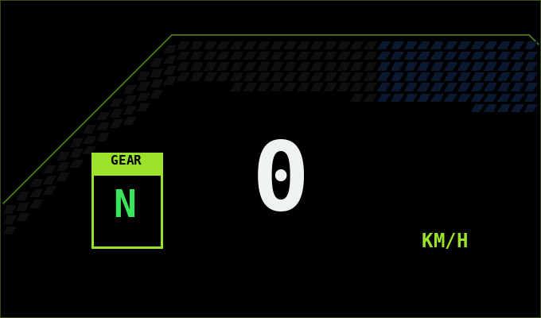

# FT150TS — App Android

App nativa (Kotlin + Jetpack Compose) para el tablero de la Italika FT150TS.
Se conecta al ESP32-S3 por Bluetooth (BLE). No necesita emparejar la moto
en los ajustes de Bluetooth: la app la busca y se conecta sola.

## Pantallas (desliza el dedo o toca las pestañas)
0. **Apps** (a la izquierda del tablero): todas tus apps como launcher, con buscador y favoritas.
1. **Tablero**: dos estilos a elegir en Ajustes:
   - **LCD Sport** (nuevo, por defecto): pantalla tipo LCD de moto deportiva en negro AMOLED,
     barra de RPM curva en bloques, velocidad en 7 segmentos, marcha, temperatura, batería de la moto,
     gasolina, reloj, TRIP/ODO/RANGO/PROMEDIO (toca la fila de abajo para cambiar) y la 18650.
   - **Clásico**: el tacómetro circular de la v1.1.
2. **Auto**: mapa con 6 estilos que te sigue, recorrido, velocidad, rumbo y altitud,
   límite de velocidad y nombre de la calle, clima, "¿dónde dejé la moto?" (botón P),
   micrófono para comandos de voz, botón "Navegar" (Google Maps), audífonos/casco con
   su batería, música (buscar, cola, apps, volumen) y lo esencial de la moto.
3. **Moto**: viaje y odómetro, estadísticas (gráficas de velocidad y RPM), mantenimiento
   (botón "Hecho" para registrar servicio), perfil ECO/SPORT, corte de motor y consola.
4. **Ajustes** (engrane): apariencia, pantalla, mapa, avisos, voz y asistente, conexión, ruta y acerca de.

Gira el teléfono a horizontal y las pantallas se acomodan solas.

## Novedades v3.0 — Vértice, seguridad y fluidez comprobable
- **Tema nuevo: Vértice** (Ajustes > Apariencia). No es solo otro color: cambia la organización.
  - En horizontal la navegación pasa a un **riel a la izquierda**, centrado: lejos de los ganchos del soporte (que en
    horizontal agarran las orillas de arriba y abajo) y sin barra arriba, así **el LCD del tablero sale más grande**.
  - **Estela:** arriba del riel, la velocidad, la marcha y una barra de RPM siguen a la vista en Auto, Moto, Apps y
    Ajustes (en el tablero sale el logo). El dato vital nunca desaparece al cambiar de sección.
  - **Línea de carrera:** una sola línea del acento corre por el riel, se engrosa en la sección activa (sigue al dedo
    al deslizar) y sale a 45° sobre el contenido. Une navegación y contenido.
  - **Losas en vez de cajas:** las tarjetas no llevan contorno; pesan como Carbono (grafito sólido) y solo marcan el
    vértice a 45° y una luz de borde que se desvanece. Fondo de fibra de carbono y un chevrón gigante casi invisible.
  - Tic háptico corto al cambiar de sección desde el riel. En vertical usa la barra integrada.
- **Medidor de fluidez** (Ajustes > Pantalla): cuadros por segundo, % de tirones y el peor cuadro, medidos por
  Android (FrameMetrics) en su propio hilo. Para comprobar en tu teléfono que todo va fluido.
- **Atajos del ícono:** mantén presionado el ícono de FT150TS → Tablero, Mapa o Moto.
- **Rodada que se cierra al apagar la moto** con **resumen por voz** ("12.4 kilómetros en 25 minutos, máxima de 78").
- **Seguridad** (detalle en [SEGURIDAD.md](SEGURIDAD.md)):
  - La app ya no se conecta a cualquier aparato Bluetooth con el servicio "Nordic UART": verifica que sea la tarjeta
    FT150TS, se queda con la primera verificada (Ajustes > Conexión > Olvidar tarjeta para cambiarla) y pide vincularla.
  - Restaurar un respaldo: se revisa completo antes de escribir, en segundo plano, con tope de tamaño, y ya no puede
    traer los ajustes de root.
  - Firmware v1.4: comandos delicados (corte de motor, calibraciones, borrar…) solo por Bluetooth vinculado o USB;
    vincular un teléfono nuevo solo en los 2 min después de encender; el WiFi de la tarjeta ya no usa la clave
    "12345678" (cada tarjeta genera la suya) y su página no acepta comandos delicados.

## Novedades v3.0 — tres temas nuevos, reposo al estacionar y baches por cuadra
- **Reposo al estacionar** (Ajustes > Modo moto). Con la moto parada y el teléfono cargando, a los 3 min (2, 3, 5 o
  10) descansan los sensores de vibración (leían cientos de veces por segundo aunque la moto estuviera apagada), el GPS
  (salvo que la tarjeta lo use) y los 120 Hz (baja a 60). La pantalla cambia a un **reloj negro AMOLED atenuado** con la
  hora y la batería, que se mueve un poco cada 30 s para no marcar la pantalla; o, si prefieres, se deja apagar.
  Despierta al instante al **dar marcha** (la carga se corta y regresa), al mover el teléfono (sensor de movimiento),
  al tocar la pantalla o al conectarse la tarjeta; y entra la animación del tablero como al dar switch.
  Es el paso antes del modo sueño (que sigue igual, a la hora).
- **Baches por cuadra, no uno por uno.** Antes avisaba cada bache por separado (5 baches = 5 avisos). Ahora hay un
  solo aviso que dice cuántos vienen ("Cuadra con baches, 4 adelante, uno fuerte"), máximo uno cada ~100 m y
  máximo dos en 250 m. Busca hasta 150 m adelante y no los revisa estando en reposo o dormida.
- **Tema nuevo: Ácido.** Cinta de peligro: el corte grande de arriba-izquierda con tres franjas paralelas a 45°, una
  cinta de rayas abajo a la derecha de cada tarjeta, franjas de peligro en dos esquinas de la pantalla y brillo tóxico.
  Va perfecto con Verde tóxico o el nuevo acento Ácido.
- **Tema nuevo: Circuito.** Pistas de circuito impreso con dobleces a 45°, pads y vías al fondo; tarjetas con los cortes
  arriba-derecha y abajo-izquierda, un pad con su pista y una fila de pines.
- **4 acentos fluorescentes nuevos:** Ácido, Verde menta neón, Naranja fluor y Rosa fluor (tu "Personalizado" y el Oro
  XOF se quedan como estaban).
- **Tema nuevo: Holo** (Ajustes > Apariencia). Visor holográfico: las cuatro esquinas cortadas a 45° en tarjetas,
  botones y barra de arriba; doble contorno (uno por dentro, tenue); la esquina de arriba-izquierda iluminada con el
  acento; una regla de marcas en las tarjetas y abajo de la pantalla; y superficies teñidas con un poquito de tu color
  de acento, como luz proyectada. Va con la barra integrada (como Filo, Pixel y Táctico) y combina con el neón.
- **Se lee mejor de un vistazo:** los números pixel de la barra de estado (satélites, batería del cel) y el chip de
  conexión subieron de 7 a 8 sp.
- **Pestañas más fáciles de atinar** en Carbono y Vidrio: 48 dp de alto como mínimo (la medida de Android), aun con guantes.
- **Respeta "Quitar animaciones"** del sistema: si las apagas en Android, la animación FT150 y la entrada al tablero
  se saltan y ves el cuadro final directo. Con las animaciones normales todo sigue igual.
- El ícono de Apps ya no se anuncia como "Ajustes" en el lector de pantalla.

## Novedades v2.9.2 — el GPS ya no se queda "perdido"
- **Se reconecta solo.** Si hay buena señal y las posiciones dejan de llegar (Android puede "congelar" el GPS de una
  app al apagar la pantalla o mandarla a segundo plano), la app pide el GPS de nuevo **sin apagarlo** (primero la
  petición nueva y luego suelta la vieja, así el chip no pierde los satélites): a los 10 s, 20 s, 40 s y luego cada
  minuto, sin límite. Antes se rendía a los 5 intentos y volvía a pedir con el mismo listener, que Android trataba como
  la misma petición congelada.
- **Al regresar a la app o prender la pantalla** revisa el GPS y, si está callado, lo revive al instante (antes no
  hacía nada si el GPS "ya estaba prendido").
- **Respaldo con el GPS de Google** (Android 12+): el fusionado en alta precisión usa los mismos satélites; si el GPS
  directo se calla pero Google tiene posición de satélite (±20 m o mejor, con velocidad y 4+ satélites fuertes), esa se
  usa para todo: velocímetro, rodadas y odómetro siguen. El chip dice "· google".
- El servicio de la moto se vuelve a poner con permiso de **ubicación** cada vez que abres la app (si Android lo había
  reiniciado solo desde segundo plano, se quedaba sin él y el GPS se callaba con la pantalla apagada).
- Una posición con la hora mal puesta ya no puede dejar al GPS rechazando todas las que siguen.
- "Perdida hace 7199 s" ahora dice "hace 1 h 59 min", y la precisión vieja ya no se muestra como si fuera actual.

## Novedades v2.9.1 — el GPS dice la verdad bajo techo
- Antes decía "buscando satélites (26 en uso)" adentro de la casa y parecía error. "En uso" engaña: los chips
  Qualcomm/Xiaomi marcan 20-30 satélites "en uso" aunque la señal no alcance para dar posición.
- Ahora cuenta los satélites con **buena señal** (25 dB-Hz o más; se necesitan al menos 4) y lo dice claro:
  "señal débil (bajo techo) · 2 sat buenos". El detalle del GPS muestra *Con buena señal*, *Marcados en uso* y
  la *Señal más fuerte* en dB-Hz (afuera llega a 35-45; bajo techo 10-25).
- Si el chip ya calculó la posición pero Android no se la pasa a la app (ahorro de batería de MIUI/HyperOS), la app
  lo detecta, vuelve a pedirla sola y te dice qué ajuste revisar.

## Novedades v2.9 — rodadas, arrancones, lluvia en tu ruta, respaldo y sorpresas
- **Rodadas** (página Moto): cada rodada se graba sola (con el cable de la moto, el motor o la tarjeta; sin ellos, solo
  con la app en pantalla) y se cierra a los 5 min parado. Distancia, tiempo, en movimiento, velocidad máxima y promedio,
  inclinación máxima. Tócala para verla en el **mapa pintado por velocidad** (verde < 25, amarillo, ámbar, rojo > 75)
  y **repetirla** x10 / x30 / x60 con un rombo que recorre la ruta, o arrastra la barra. Se exporta como GPX.
  Si la app se cierra a media rodada, se guarda lo que alcanzó a grabar.
- **Aviso de descanso**: con 1.5 h rodando sin parar te sugiere una pausa por voz.
- **Modo arrancones** (página Moto, solo en lugar cerrado y seguro): la salida se detecta con el acelerómetro (filtro
  que ignora la vibración del motor, leído a la velocidad máxima del sensor) y los tiempos 0-40, 0-60, 0-80, 100 m y
  1/8 de milla (201 m) se calculan entre lecturas del GPS. **Semáforo** opcional (3 ámbar + verde) con **tiempo de
  reacción** y "salida en falso". Récords guardados.
- **Prueba de frenado 40→0**: metros, segundos y frenada máxima en g.
- **Lluvia en tu ruta** (Ajustes): rodando, cada 10 min revisa el pronóstico 4, 8, 12 y 16 km adelante en la dirección
  en que vas y, con tu velocidad, si va a llover cuando pases. Aviso en el tablero y por voz.
- **Velocímetro vs GPS** (página Moto): toca el número que marca la aguja (o dile al asistente "marca cuarenta") y se
  compara con el GPS de los últimos 5 s. Con varias medidas te dice cuánto marca de más y a cuánto vas de verdad.
- **Respaldo y restaurar** (Ajustes): todo en un archivo .json: guárdalo donde quieras, compártelo o deja el
  automático semanal en Descargas/FT150TS. Al restaurar, la app se reinicia.
- **Sorpresas**: 14 **logros pixel** (con aviso al ganarlos) y un **secreto escondido en el logo**.

## Novedades v2.8.1 — animación al entrar al tablero
- Cada vez que entras al tablero (cambiando de página, al prender la pantalla o después de la animación FT150),
  como una moto de verdad al dar switch: una **franja a 45° del acento barre la pantalla**, la **barra / aguja de RPM
  sube hasta el tope** (con la inercia del PID) y regresa a las RPM reales, el shift light se llena y destella, y los
  dígitos hacen la **prueba de segmentos (888)**. Dura 1.7 s. Ajustes > Apariencia > "Animación al entrar al tablero".

## Novedades v2.8 — más temas, neón, colores y barra de RPM a 45°
- **Barra de RPM del LCD** (Ajustes > Apariencia > Barra de RPM): *Curva* (la de siempre: sube redondeado y sigue
  recta) o *Diagonal 45°*: sube en línea recta exacta a 45°, con bloques inclinados y un riel encima que remata con un
  corte a 45°. "Según el tema" usa la diagonal en Filo, Pixel y Táctico.
- **Tema Pixel**: los cortes a 45° hechos con escalones de pixel, bordes gruesos, cuadritos del acento en cada escalón,
  fondo de puntos grandes y líneas de barrido.
- **Tema Táctico**: visor militar: esquinas con corchetes, retícula de cruces, marcas de mira en la barra de arriba.
- Filo, Pixel y Táctico usan la **barra integrada** (segmentos con el resaltado que se desliza), cada uno con su forma.
- **Efecto neón** (switch): halo alrededor de las tarjetas, el marco, la barra de arriba, el tablero LCD y los bloques
  prendidos de la barra de RPM; los bordes se pintan del acento.
- **Colores de acento**: 14 + **personalizado** (tono e intensidad con deslizadores).
- **Fondo**: puntos, rejilla, rayas a 45° o negro puro.
- **GitHub**: el proyecto trae `README.md`, `.gitignore`, el firmware del ESP32 en `firmware/` e imágenes en `docs/`.

## Novedades v2.7 — tema Filo, accesos más arriba y animación al abrir el switch
- **Tema Filo** (Ajustes > Apariencia > Tema): HUD más brusco e integrado.
  - Tarjetas con cortes a 45° grandes (y las otras dos esquinas mordidas); el corte de arriba se marca con el acento
    y se alarga por las orillas, el de abajo más tenue, y tres pixeles en la esquina.
  - La barra de arriba ya no son pestañas: son segmentos cortados a 45° unidos, y el resaltado **se desliza con
    el dedo** mientras cambias de página. Debajo, una línea gruesa que baja a 45° y conecta con la tira de estado.
  - Toda la pantalla queda dentro de un marco tipo visor con esquinas a 45° y rayas de advertencia tenues.
  - El tablero LCD lleva los mismos acentos HUD.
- **Tira de estado** en el espacio libre de arriba a la derecha (en los tres temas): hora, señal del GPS en barritas,
  batería del cel (con rayo si carga) y temperatura (en pantallas angostas se queda con lo principal).
- **Accesos directos más arriba**: los 4 del tablero suben 0.5 cm (centímetros reales de la pantalla) para librar
  los ganchos del soporte. Ajustable en Ajustes > Launcher > "Subir los 4 accesos del tablero" (centrados a 1.5 cm).
- **Animación FT150 al abrir el switch**: si conectas el switch con la pantalla apagada (o estando en otra app),
  al ver la app sale la animación de arranque. Va encima de las páginas: el mapa y todo lo demás ya no se
  vuelven a armar (antes, al ver la animación desde Ajustes se recargaba todo); tocar la salta.
- **Fluidez**: la aguja PID va pegada a los cuadros de la pantalla (sin tirones a 120 Hz); con la animación encima
  las páginas dejan de actualizarse; el resaltado de la barra se mueve sin redibujar el resto.
- Tip de fluidez: instala la versión release (`./gradlew installRelease`): sin modo depuración y con R8 va
  bastante más fluida que la debug, y se instala encima sin borrar nada (usa la misma firma).

## Novedades v2.6 — modo sueño
- **Modo sueño** (Ajustes > Modo moto > Modo sueño, prendido de fábrica): si el teléfono está **cargando pero no se
  mueve** (lo quitaste de la moto y lo pusiste a cargar en la mesa, o la moto se quedó con el switch prendido), después
  de **1 h** (30 min / 1 h / 2 h) la app se duerme:
  - apaga el GPS, los sensores de vibración (RPM y baches) y la dashcam;
  - deja que la pantalla se apague (aunque tengas "pantalla siempre encendida");
  - busca la tarjeta de la moto solo cada 2 min y en modo ahorro (antes, con el cargador puesto, buscaba sin parar);
  - no cambia de página ni guarda "dónde dejé la moto".
- **Cada 30 min** (15 / 30 / 60) prende la ubicación hasta 2 min: si se alejó más de 150 m (o va rodando), despierta.
  Adentro, si el GPS no agarra, usa la aproximada (wifi).
- **También despierta** si tocas la pantalla, si el sensor de movimiento del teléfono siente que lo llevas, si se
  desconecta el cargador (o se corta al dar marcha), si lo pones en el soporte con NFC o si se conecta la tarjeta.
- La notificación "App activa" dice cuándo está dormida y a qué hora revisa; en Ajustes ves cuánto falta para que se
  duerma, lo último que pasó y el botón "Dormir ahora" para probar.
- Con la pantalla apagada las páginas ya no cuentan como visibles: el mapa y la brújula descansan aunque te hayas
  quedado en la página Auto.

## Novedades v2.5 — GPS arreglado (adentro y afuera)
- **Falla de la v2.2–v2.4**: si en 12 s no llegaba posición, la app apagaba y prendía el GPS cada ~20 s. Eso reinicia la
  búsqueda de satélites, y adentro de la casa (donde la primera señal tarda más) nunca la dejaba agarrar: los satélites
  sí se veían (p. ej. 19 de 44) pero nunca llegaba la posición. Ahora el GPS **nunca se apaga y prende solo**; si ya
  llegaban posiciones y dejan de llegar con satélites a la vista, solo renueva la petición sin soltarlo.
- **Ubicación aproximada** (wifi/antenas, casi no gasta) para el mapa mientras el GPS agarra señal. No cuenta para
  velocidad, recorrido, odómetro ni baches. El chip dice "aprox" y el aviso del mapa "mapa aprox.".
- **Pasivo**: si otra app (Maps, Waze) consigue posición del GPS, la app también la usa.
- La edad de la señal se mide con la hora en que llegó al teléfono; "Buscando satélites…" cuando todavía no llega la
  primera (antes decía "Perdida hace 141 s" contando la última posición guardada de Android). Al pausar se borran los
  números viejos de satélites.

## Novedades v2.4 — mapa que gira suave y marchas que no se equivocan
- **Giro del mapa con PID**: la brújula ahora lee ~50 veces por segundo (antes 5) y el mapa gira a 60 cuadros con un
  PID como el de la aguja (un giro de 90° llega en ~0.45 s, sin pasarse ni rebotar, y siempre por el lado corto:
  de 350° a 10° gira 20°). Ya no va en escalones de 3° ni reinicia la animación del centro con cada cambio de rumbo.
  El cambio entre brújula y GPS tiene margen (GPS arriba de 9 km/h, brújula abajo de 6) para que no brinque.
- **Marcha por velocidad + RPM** (sin la tarjeta): un filtro de probabilidad junta
  1) qué marchas son posibles a esa velocidad (el motor tendría que andar entre ~1800 y 9800 rpm: a 17 km/h no puede ser 4ª),
  2) qué tan bien cuadran las RPM ÷ velocidad con cada marcha y 3) la marcha que traías (se cambia de una en una).
  Con el clutch apretado sostiene la que traías, y lo que se muestra solo cambia cuando la nueva es clara medio segundo.
  En simulación con lecturas malas y embragues: 98 % bien contra 88 % del método anterior.
- Las mismas marchas posibles ayudan a escoger bien la línea de las RPM (ya no toma el ralentí como "4ª" rodando).
- **Marchas aprendidas con topes**: solo aprende con la marcha segura (≥ 85 %), no se aleja más de ±20 % de lo de fábrica
  ni se encima con la de junto; si lo guardado estaba descompuesto, se regresa solo a lo de fábrica.
- **Ajustes > Sin la tarjeta > Marchas**: marcha actual con qué tan segura está, relación de cada marcha y entre qué
  velocidades puede ir.

## Novedades v2.3 — aguja PID, batería del cel e íconos
- **Aguja con PID**: la aguja de RPM (tablero Clásico y barras del LCD Sport) ya no salta al número: tiene "masa" y un
  controlador PID la lleva al valor, como un tacómetro de verdad (sube rápido, frena sin pasarse). Las RPM que deciden el
  cambio (shift light) siguen siendo las reales, sin retraso.
- **Ajustes > Control PID**: prender/apagar, deslizadores **Kp** (fuerza), **Ki** (corrige lo que falta) y **Kd** (freno),
  gráfica de un salto de 1500 a 7000 rpm que se redibuja al mover los valores, y **sobrepaso**, **tiempo en asentarse** y
  **amortiguamiento ζ** (ζ < 1 rebota, ≈ 1 justo, > 1 lenta). "Valores de fábrica" regresa a 400 / 10 / 35.
- **Batería del cel** (página Moto): %, watts que entran o salen, voltaje, corriente (mA), temperatura, salud, ciclos
  (Android 14+), cuánto falta para llenarse y gráfica de las últimas 2 h.
- **Testigo de batería** en el tablero: pila pixel con rayo y watts cuando carga (sirve para ver si el cable de la moto
  sí está cargando).
- **Avisos**: "Cel no carga" si la moto vibra prendida pero el teléfono no está cargando (cable flojo o cargador de la
  moto fallando) y batería baja (≤ 15 %) en modo moto.
- **Íconos**: Ajustes > Launcher > Íconos de las apps: **Normales / Pixel color / Pixel LCD** (este último en tonos del tablero).
  Las pestañas Tablero, Auto y Moto llevan su ícono pixel.

## Novedades v2.2 — RPM estables, GPS que no se congela, brújula y más fluidez
- **RPM más estables** (sin la tarjeta): el espectro se promedia con el anterior (quita ruido de baches y viento) y
  las RPM pasan por un **filtro de Kalman** con rechazo de brincos sueltos (mediana de 3); un cambio de marcha real se
  acepta en ~0.75 s. Ajustes > Sin la tarjeta > Suavizado: Rápido / Normal / Suave.
- **Motor solo con el cable conectado** (prendido de fábrica): sin el cable de la moto (switch apagado) no marca motor
  ni RPM aunque el teléfono sienta vibración en la mano o en la mesa.
- **GPS**: la velocidad se calcula con la edad real de la posición (reloj interno, no la hora del GPS); si la señal se
  pierde marca "--" en vez de quedarse congelada, y si el teléfono deja de mandar posiciones el GPS se vuelve a pedir solo.
- **Chip GPS** en el mapa: satélites usados, precisión (±m), doble frecuencia L5 y sistemas (GPS, Galileo, BeiDou,
  GLONASS). Al tocarlo: coordenadas, brújula, **"Aquí es mi casa"**, **"Llévame a casa"** y compartir ubicación.
- **Brújula del teléfono**: parado o despacio (< 8 km/h) el mapa gira y el rumbo sale con la brújula (norte verdadero);
  rodando, con el GPS. Botón de brújula pixel en el mapa (tócalo para girar el mapa con tu rumbo).
- **Fluidez**: todas las páginas se quedan armadas (cambiar de pestaña ya no se traba) y las que no se ven dejan de
  actualizarse; los parpadeos son a saltos (~5 por segundo) en vez de animaciones a 120 cuadros; los datos del
  teléfono se redondean para no redibujar sin cambios; los íconos pixelados se pintan al leer las apps, fuera de la pantalla.

## Novedades v2.1 — el teléfono como computadora de la moto
- **Teléfono caliente** (Ajustes > Teléfono caliente): mira la temperatura de la batería y el estado térmico de
  Android. A 43 °C baja a 60 Hz, suelta el brillo máximo y pausa la dashcam; avisa en el tablero ("Cel 44°") y por voz.
- **Etiqueta NFC en el soporte** (Ajustes > Modo moto): registra cualquier sticker NFC (NTAG213/215); al poner el
  teléfono entra al modo moto aunque no cargue, y al quitarlo (con la app en pantalla) pasa a tus apps. La etiqueta
  queda grabada con un enlace para abrir la app. Mientras la app está al frente con esto prendido, pagar con NFC no funciona.
- **Odómetro y mantenimiento en el teléfono** (página Moto, sin la tarjeta): km por GPS solo cuando estás en la moto,
  hoy/ayer, igualar con el odómetro real; aceite, cadena, filtro, bujía y frenos por km y días con aviso al montar.
- **Bitácora de gasolina** (página Moto): litros, precio y odómetro; km/L reales (de lleno a lleno), km que te quedan
  (tanque de 13.3 L), costo por km y gasto del mes. Aviso de reserva a 30 km. La fila de abajo del LCD
  (TRIP/ODO/RANGO/PROM) se llena con esto cuando no está la tarjeta.
- **Salud del ralentí** (página Moto): con motor caliente y parado mide el ralentí por vibración y qué tan estable es.
- **Dónde dejé la moto**: se guarda solo al apagarla o quitar el teléfono (deja de cargar / sale de la etiqueta).
- **Dashcam** (Ajustes > Dashcam): cámara de atrás en bucle de 5/10/20 min, 720p o 1080p, sin audio. "Guardar clip"
  o tocar REC en el tablero copia los últimos 3 min a Películas/FT150TS; un golpe muy fuerte lo guarda solo.
  Graba solo con la app en pantalla y se pausa si el teléfono se calienta.
- **Altitud y pendiente** (página Moto): altitud por GPS, pendiente de los últimos ~150 m, subida y bajada del viaje.
- **Mapa de baches** (Ajustes > Mapa): siente los golpes de arriba-abajo (filtrando la vibración del motor), los marca en
  el mapa (ámbar/rojo) y te avisa por voz antes de llegar a uno conocido. Sensibilidad baja/media/alta.
- **Luz del día real** (Ajustes > Mapa): con el sensor de luz el mapa pasa a Noche de noche o en túneles.
- **Más fluidez**: las páginas lejos de la que ves no se dibujan, el mapa no se dibuja escondido y los íconos pixelados
  se pintan una sola vez (antes eran 256 cuadritos por ícono en cada cuadro).

## Novedades v2.0 — RPM por vibración (sin la tarjeta)
Mientras la tarjeta (ESP32) no esté conectada, el teléfono hace de sensor de la moto:
- **RPM** con la vibración del motor que siente el acelerómetro (espectro FFT de los 3 ejes, buscando la línea
  del cigüeñal y sus múltiplos). Se lee lo más rápido que dé el sensor (permiso HIGH_SAMPLING_RATE_SENSORS).
- **Velocidad** por GPS, **marcha** con RPM ÷ velocidad (las relaciones de cada marcha se ajustan solas al rodar
  parejo), **inclinación** con el giroscopio (asin(v·ω/g)) y **aceleración/frenada** con el GPS.
- Alimenta el tablero LCD, el shift light, las gráficas y las mismas estadísticas y récords: no se borra nada.
- En cuanto se conecta la tarjeta, ella manda y esto se pausa. Testigo "RPM cel" en el tablero.
- Ajustes > Sin la tarjeta: prender/apagar, ralentí de tu moto, **Calibrar en ralentí** (neutral, motor caliente,
  teléfono en el soporte, 6 s), RPM del shift light y borrar calibración.
- Es aproximado (en simulación: ~5 % de error calibrado con 400 lecturas/s). Si tu acelerómetro da menos de
  300 lecturas/s, las RPM altas pueden fallar; Ajustes muestra cuántas da.

**Para no perder tus datos al actualizar:** instala encima (`./gradlew installDebug` o `adb install -r`), no
desinstales. Compila siempre en la misma compu (la firma debug cambia de una compu a otra).

## Novedades v1.9 — tablero más grande, mapas arreglados, alertas y página Moto completa
- **Tablero más grande**: el LCD crece hasta llenar el alto de la pantalla y los datos de al lado se acomodan
  en lo que sobra. "Datos compactos" (Ajustes > Pantalla, prendido de fábrica) hace más chicas las tarjetas
  de inclinación, perfil, viaje, batería y clima.
- **Botones de Android** (Ajustes > Pantalla): Normal, Sin botones o Completa. Dentro de la app se esconden los
  botones de atrás/inicio/recientes (y la barra de estado en Completa); desliza desde la orilla para verlos.
- **Gestos de Xiaomi con este launcher** (Ajustes > Root, experimental): HyperOS pone los 3 botones cuando el
  launcher no es el suyo; esto regresa los gestos y se vuelve a aplicar al abrir la app (HyperOS lo quita al
  reiniciar). Sin root: `adb shell settings put global force_fsg_nav_bar 1`.
- **Mapas sin "API key required"**: CARTO empezó a pedir llave. Noche y Claro ahora usan OpenStreetMap con
  filtro de color (sin llave). Si quieres los de CARTO, saca una llave gratis y pégala en Ajustes > Mapa.
- **Alertas** (Ajustes > Avisos): huracanes y tormentas tropicales cerca (NHC/NOAA, Pacífico y Atlántico),
  tormenta eléctrica, granizo, rachas fuertes, lluvia intensa, calor, UV y niebla (Open-Meteo), y sismos
  reportados a menos de 400 km (USGS, informativo). Salen en el tablero, en el LCD, por voz y con notificación.
  No sustituyen los avisos de Protección Civil ni del SMN.
- **Página Moto**: en horizontal va en dos columnas.
  - Sensores en vivo (todo lo que manda la tarjeta).
  - Estadísticas de manejo: tiempo rodando/parado, distancia, promedio, vel/RPM máx, inclinación, aceleración y
    frenada (g), temperatura máx, voltaje mín, arranques 0-40/0-60/0-80 con récords, tiempo en cada marcha y en
    qué RPM manejas.
  - Gráficas de 2, 10 o 30 minutos.
  - Mantenimiento: toca un renglón para cambiar cada cuántos km/días.
  - Control: perfil, corte, fuente de velocidad, brillo automático, WiFi, pantalla del LCD, calibraciones
    (inclinación, batería, gasolina, marchas), odómetro, estado, eventos, respaldo, reiniciar, modo ahorro y
    valores de fábrica.
  - Información de la tarjeta: firmware, tiempo encendida, memoria, temperatura del chip, sensores, puntos de
    cambio por marcha.
- **Firmware v1.3** (para brillo, WiFi, reinicio e información de la tarjeta): comandos `cfgjson`,
  `brillo auto|fijo`, `wifi on|off` y `reiniciar`. Recuerda poner `#define MODO_SIMULADOR 0` para la moto.

## Novedades v1.8 — accesos directos, íconos pixel y modo moto
- **Accesos directos en el tablero**: 4 lugares a la izquierda del tablero (abajo si el teléfono está
  vertical), aparte de la página de apps. Toca un **+** para asignar una app; mantén presionado para
  cambiarla o quitarla. Se ocultan en Ajustes > Launcher.
- **Íconos pixelados**: todas las apps (accesos, favoritas, cajón y selector) se dibujan en cuadritos
  de 16x16, al estilo del LCD. Se apaga en Ajustes > Launcher.
- **Mantener activa en segundo plano**: notificación fija "App activa" para que Android/MIUI no la cierre;
  sigue conectada a la moto, con el GPS y las notificaciones. Botón "Detener" en la misma notificación.
- **Modo moto** (Ajustes > Modo moto): el cable de la moto carga el teléfono solo con el switch prendido.
  - Empieza a cargar → está en la moto → **tablero** (y si estabas en otra app, regresa sola).
  - Deja de cargar (apagaste la moto o lo quitaste del soporte) → **tus apps**.
  - Un corte de menos de 8 s (al dar marcha) no cuenta.
  - "Solo con la moto conectada": además pide que la tarjeta esté conectada por Bluetooth, para que no
    se active con el cargador de tu casa.
  - Para abrirse sola desde otra app, Android pide **"Mostrar sobre otras apps"** (botón en Ajustes) o root.
  - Con Pantalla encendida en **"Con la moto"**, la pantalla se queda prendida mientras esté montada y se
    apaga sola al apagar la moto.
  - Con el modo launcher, el botón Inicio lleva al tablero en la moto y a tus apps en la mano.
- **Root**: nuevo interruptor general "Usar funciones root" y "Pantalla de inicio (root)" ahora es un
  interruptor (apagado regresa el launcher de siempre).

## Novedades v1.7 — funciones con root (Magisk), en Ajustes > Root
Todo es opcional; la app pide root solo cuando usas una opción y Magisk pregunta si lo permites.
- **Dar permisos y quitar ahorro de batería**: ubicación, Bluetooth, acceso a notificaciones y que
  MIUI/Android no cierre la app en segundo plano.
- **Ponerla como pantalla de inicio** con un toque.
- **Manzanita en ventana flotante** (experimental): la app elegida se abre en un recuadro encima del mapa.
  Activa las ventanas flotantes de Android; algunos teléfonos piden reiniciar la primera vez. Si esa app
  ya estaba abierta en pantalla completa, ciérrala en recientes antes.
- **Despertar al prender la moto**: cuando la moto se conecta, se prende la pantalla y se abre el tablero.
- **Tablero sobre la pantalla de bloqueo** (no necesita root): se ve sin desbloquear, como Maps navegando.

Lo que el root no cambia: el micrófono que usa el Asistente de Google lo sigue eligiendo Google, y cambiar
de audífonos Bluetooth sigue siendo con el selector de Android.

## Novedades v1.6 — modo launcher
- **Página de apps** a la izquierda del tablero: hora grande, clima, favoritas, buscador y todas tus apps.
  Toca para abrir; mantén presionada para fijarla en favoritas, ponerla en la manzanita o ver su información.
- **Usar como pantalla de inicio** (Ajustes > Launcher, apagado de fábrica): el botón Inicio del teléfono
  te regresa al tablero y Atrás ya no cierra la app. Android no deja que una app se ponga sola como inicio:
  al prenderlo se abre el ajuste para elegirla.
- **Botón manzanita** en el mapa: abre la app que tú elijas (mantén presionado para cambiarla).
  Android no permite meter la pantalla de otra app dentro de un recuadro: se abre encima y regresas
  con Inicio (en modo launcher) o Atrás.
- **Franja para deslizar**: la barra de arriba y la línea bajo ella cambian de página aunque el mapa ocupe todo.

## Novedades v1.5 — iPhone (necesita el firmware v1.2 en la moto)
- **El iPhone se conecta a la moto**, sin instalar nada en el iPhone: usa los servicios
  Bluetooth que iOS trae para accesorios (ANCS para notificaciones, AMS para música y CTS para la hora),
  los mismos que usan los relojes que no son de Apple.
- **Notificaciones del iPhone** (WhatsApp, Mensajes, llamadas...) en el LCD de la moto y en la app.
- **Música del iPhone** (Apple Music, Spotify...): canción, artista, tiempo y controles
  (anterior, play/pausa, siguiente, volumen) desde la app o con los botones de la moto
  (pantalla IPHONE: OK = play/pausa, OK largo = siguiente).
- **Llamadas**: aviso en la app con **Contestar / Rechazar**, y en la moto OK = contestar,
  OK largo = colgar.
- La moto toma la **hora del iPhone**.
- La app de Android y el iPhone pueden estar conectados a la moto **al mismo tiempo**.

### Vincular el iPhone
1. Sube el firmware v1.2 al ESP32 (con `MODO_SIMULADOR 0`).
2. En el iPhone: **Ajustes > Bluetooth**, toca **FT150TS** y luego **Vincular**.
3. Acepta **Compartir notificaciones del sistema**.
4. Listo: la próxima vez se conecta solo. Para empezar de cero, en la consola escribe `ios olvidar`
   y en el iPhone toca FT150TS > **Omitir este dispositivo**.

Lo que no se puede: mandar el destino de navegación desde el iPhone. Apple solo comparte la navegación
con CarPlay (accesorios certificados). La navegación se pone desde la app del Android (por voz,
recientes o atajos).

## Novedades v1.4
- **Fluidez máxima**: la app pide la tasa de refresco más alta de tu pantalla (120 Hz en un Poco F4).
  En MIUI/HyperOS pon también Ajustes > Pantalla > Tasa de refresco > Personalizada / 120 Hz.
- **Estilos de mapa**: Noche (CARTO, negro de verdad para AMOLED), Oscuro clásico, Estándar, Claro,
  Terreno y Satélite. **Noche automática** al oscurecer. Caché de mapas de hasta 2 GB.
- **Audífonos / casco Bluetooth**: nombre y **porcentaje de batería** (si el casco lo manda),
  por dónde está sonando y botón para **cambiar la salida de audio**. Testigo "AUD %" en el tablero.
- **Límite de velocidad por calle**: señal redonda que **parpadea** si vas más rápido, y el nombre
  de la calle. Sale de OpenStreetMap; si la calle no lo tiene, se aproxima por tipo de vía
  (autopista 110, carretera 80, avenida 60/50, calle 40/30) y dice "APROX".
  El aviso de velocidad ahora puede ser **fijo** o **según la calle**.
- **Comandos de voz** (micrófono en el mapa): "pon…", "siguiente", "pausa", "llévame a…",
  "gasolinera", "clima", "¿dónde está mi moto?", "comparte mi ubicación", "batería", "límite"...
  Mantén presionado el micrófono para el **Asistente de Google**.
- **Micrófono del casco**: en Ajustes > Voz elige "Casco / audífonos" para hablarle a la app por Bluetooth.
- **Navegar**: atajos a gasolinera, taller de motos, llantera, hospital y cajero, y destinos recientes.
- **Compartir mi ubicación** por WhatsApp/Telegram (botón P o por voz).

## Novedades v1.3
- **Clima** con la ubicación del teléfono (Open-Meteo, gratis y sin cuenta): chip en el mapa,
  tarjeta en el tablero y detalle con próximas 6 horas, sensación, máx/mín, humedad y viento.
  Botones para **escucharlo en voz alta** y **mandarlo al LCD de la moto**. Avisa si viene lluvia.
  Se actualiza cada 15 min solo con la app en pantalla y guarda el último por si no hay internet.
- **Música**: barra de la canción (tócala para adelantar), **buscar y reproducir** escribiendo
  o **por voz**, elegir en qué app (Spotify, YouTube Music...), ver la **cola** y saltar a una
  canción, elegir qué app controlar si hay varias, y volumen − / +.
- **¿Dónde dejé la moto?**: se guarda sola al apagar la moto; botón P en el mapa para verla
  o llegar caminando con Google Maps.
- **Aviso de velocidad** (Ajustes > Avisos): vibra y la velocidad parpadea en rojo si pasas el límite.
- **Avisos por voz**: el teléfono dice en voz alta la lluvia cercana y el exceso de velocidad.
- **Pantalla encendida** (Ajustes > Pantalla): Siempre, Solo con la moto conectada o Normal.
- **Optimización**: el tablero LCD se redibuja sin recomponer la pantalla, cada pieza lee solo
  sus datos, las páginas ocultas apagan relojes y animaciones, las portadas se reducen a 256 px,
  los datos de la música se guardan en vez de pedirlos otra vez, el mapa no anima si no lo ves
  y su caché en disco baja de 600 a 200 MB.

## Novedades v1.2
- **Tablero LCD Sport**: inspirado en las pantallas digitales de moto deportiva, solo la parte
  digital (sin carátula), con todos los datos que ya tenía la app.
- **Shift light de 3 zonas** en estilo pixel: verde (bajas), ámbar (medias) y azul (altas).
  Se puede cambiar a verde · blanco · azul, verde · cian · azul o el clásico verde · blanco · rojo.
- **Temas de la app**: **Carbono** (sólido, esquinas cortadas) y **Vidrio** (translúcido y
  redondeado, estilo iOS, con brillos de color de fondo). El vidrio es simulado, sin desenfoque,
  para no gastar batería.
- **6 colores de acento**: lima, cian, ámbar, rojo, morado y plata (el mapa también cambia).
- Fondo negro puro con cuadrícula de puntitos pixel (en AMOLED el negro no gasta batería).
- **Página de Ajustes** ordenada por secciones, con vistas previas de cada tema y tablero,
  botón para probar el shift light y "Restablecer apariencia".
- Nuevas funciones: siempre horizontal, brillo al máximo, gráficas de los últimos 2 minutos,
  exportar la ruta como **GPX** (Google Earth, Strava, OsmAnd...), crédito de OpenStreetMap
  en el mapa y **Acerca de** (versión, créditos y botón para ver otra vez la animación de inicio).

## Novedades v1.1
- Estilo de la FT150TS: negro, verde lima y plata, esquinas cortadas tipo carenado,
  detalles pixelados y tipografías Chakra Petch, Russo One y Press Start 2P.
- Animación de arranque: cortina de franjas, logo FT150 TS, ITALIKA y firma de XOF
  con barra de carga pixelada (toca la pantalla para saltarla).
- Optimización: las animaciones de parpadeo solo corren cuando hay alerta o zona roja,
  el tacómetro reutiliza sus números, el GPS se apaga cuando la app no está en pantalla
  (salvo que le esté prestando ubicación a la moto) y la versión release usa R8.

## Instalar la versión optimizada (recomendado, va más fluida)
1. En Android Studio abre **Build Variants** (barra izquierda, o View > Tool Windows > Build Variants).
2. En el módulo `app` cambia **debug** por **release**.
3. **Build > Build App Bundle(s) / APK(s) > Build APK(s)**.
4. El archivo queda en `app/build/outputs/apk/release/app-release.apk`. Instálalo con:
   `& "$env:LOCALAPPDATA\Android\Sdk\platform-tools\adb.exe" install -r app\build\outputs\apk\release\app-release.apk`
   (o mándalo al teléfono y ábrelo).
Si la versión release se cerrara sola al abrir, en `app/build.gradle.kts` pon
`isMinifyEnabled = false` e `isShrinkResources = false` y vuelve a compilar.

## Cómo compilar e instalar
1. Instala **Android Studio** (gratis): https://developer.android.com/studio
2. Abre esta carpeta (`File > Open` y elige `FT150TS-App`).
3. Espera a que termine "Gradle sync" (la primera vez descarga todo, tarda varios minutos).
   Si pide instalar el SDK 35 o aceptar licencias, acepta.
4. En tu teléfono activa **Opciones de desarrollador > Depuración USB** y conéctalo por USB.
5. Dale al botón verde **Run ▶**. La app se instala y abre.

Para sacar un APK e instalarlo sin cable:
`Build > Build App Bundle(s) / APK(s) > Build APK(s)`. El archivo queda en
`app/build/outputs/apk/debug/app-debug.apk`; mándalo a tu teléfono y ábrelo.

## Permisos que pide
- **Bluetooth cercano** y **ubicación**: para encontrar la moto y mostrar el mapa.
- **Acceso a notificaciones** (se da en Ajustes, la app te lleva): para controlar la música
  y mandar llamadas y mensajes a la pantalla de la moto. Sin este permiso todo lo demás funciona.
- **Internet**: mapa, clima y límites de velocidad. **Vibración**: aviso de velocidad.
- **Bluetooth cercano** también sirve para leer la batería de tus audífonos o casco.
- **Notificaciones**: solo para la notificación fija "App activa" (segundo plano).
- **Mostrar sobre otras apps** (opcional): para que el tablero se abra solo al montar el teléfono.

## Para usarla con la moto
- En el firmware pon `#define MODO_SIMULADOR 0` (en modo simulador el Bluetooth está apagado).
- Partition Scheme: **Huge APP (3MB No OTA)**.
- Al conectar, la app pone la hora del teléfono en el reloj de la moto y le presta el GPS
  del teléfono (la moto no lleva módulo GPS). Se apaga en Ajustes > Conexión.
  Con "Mantener activa en segundo plano" la moto sigue recibiendo la ubicación aunque uses otra app.

## Modo demo
En **Ajustes > Conexión**, activa "Modo demo" para ver la app funcionando
con datos simulados, sin la moto.

## Archivos principales
| Archivo | Qué hace |
|---|---|
| `BleManager.kt` | Busca la moto, se conecta, recibe datos y manda comandos |
| `Moto.kt` | Estado central, ajustes y modo demo |
| `Modelo.kt` | Formato de los datos que manda el ESP32 |
| `Musica.kt` | Control de Spotify / YouTube Music, etc. |
| `NotifListener.kt` | Lee llamadas y mensajes y los manda a la moto |
| `Ubicacion.kt` | GPS del teléfono y recorrido |
| `Apariencia.kt` | Tema, acento, estilo del tablero y colores del shift light (se guardan) |
| `Gpx.kt` | Exporta la ruta como archivo GPX |
| `Clima.kt` | Clima (Open-Meteo), aviso de lluvia y texto para la voz |
| `Voz.kt` | Voz del teléfono (texto a voz) |
| `Estacionamiento.kt` | Dónde quedó la moto |
| `ui/ClimaUi.kt` | Íconos pixel del clima, chip, tarjeta y detalle |
| `Mapas.kt` | Estilos del mapa (OpenStreetMap con filtros, CARTO con llave, OpenTopoMap, Esri) |
| `LimitesVia.kt` | Límite de velocidad de la calle (OpenStreetMap / aproximado) |
| `AudioSalida.kt` | Audífonos y casco Bluetooth: batería, salida y micrófono |
| `ComandosVoz.kt` | Comandos de voz de la app |
| `Acciones.kt` | Navegar, caminar a la moto, compartir ubicación, Asistente |
| `Pantalla.kt` | Tasa de refresco (90/120 Hz) |
| `Lanzador.kt` | Modo launcher: apps instaladas, favoritas, manzanita, pantalla de inicio |
| `ui/PantallaApps.kt` | Página de apps (launcher) |
| `Root.kt` | Funciones con root (Magisk) |
| `Energia.kt` | Modo moto: detecta la carga del cable de la moto (tablero / apps) |
| `ServicioMoto.kt` | Mantiene la app viva en segundo plano (notificación "App activa") |
| `ui/IconosApp.kt` | Íconos pixelados y accesos directos del tablero |
| `ui/Barra.kt` | Barra integrada del tema Filo y tira de estado (hora, GPS, batería, clima) |
| `ui/Arranque.kt` | Animación al entrar al tablero (barrido a 45° y RPM al tope) |
| `Rodadas.kt` | Bitácora de rodadas, recorrido guardado y aviso de descanso |
| `Arrancones.kt` | Modo arrancones, semáforo y prueba de frenado |
| `LluviaRuta.kt` | Lluvia adelante en tu camino (Open-Meteo) |
| `Velocimetro.kt` | Error del velocímetro contra el GPS |
| `Respaldo.kt` | Respaldo y restaurar todos los datos |
| `Logros.kt` | Logros pixel |
| `ui/PantallaExtras.kt` | Pantallas de rodadas, arrancones, velocímetro, logros, respaldo y lluvia en ruta |
| `Alertas.kt` | Huracanes (NHC), clima severo, sismos (USGS) y sus avisos |
| `Estadisticas.kt` | Estadísticas de manejo y récords (0-40/60/80, g, marchas, RPM) |
| `ui/AlertasUi.kt` | Franja de alerta del tablero y detalle de alertas |
| `RpmVibracion.kt` | Cálculo de RPM con la vibración (FFT, armónicos, marcha) |
| `TelefonoMoto.kt` | Sensores del teléfono como sensor de la moto (sin la tarjeta) |
| `Termico.kt` | Teléfono caliente: temperatura, avisos y protección |
| `NfcMoto.kt` | Etiqueta NFC del soporte |
| `Odometro.kt` | Odómetro y mantenimiento del teléfono, altitud/pendiente, dónde dejé la moto |
| `Gasolina.kt` | Bitácora de gasolina |
| `Baches.kt` | Mapa de baches |
| `Luz.kt` | Sensor de luz (noche real) |
| `Dashcam.kt` | Dashcam en bucle (CameraX) |
| `Brujula.kt` | Brújula del teléfono (sensor de rotación, norte verdadero) |
| `Pid.kt` | Controlador PID, aguja con inercia (gráfica en Ajustes) y giro suave del mapa |
| `Marcha.kt` | Marcha con velocidad + RPM (filtro de probabilidad) |
| `Sueno.kt` | Modo sueño: cargando y quieto → se duerme y revisa cada rato si se movió |
| `BateriaTel.kt` | Batería del teléfono: %, watts, voltaje, salud, ciclos, historial y avisos |
| `ui/PantallaMotoTel.kt` | Secciones de la página Moto del teléfono (mantenimiento, gasolina, ralentí, altitud) |
| `ui/Tema.kt` | Colores, formas (Carbono / Vidrio), fondo pixel y tipografías |
| `ui/TableroLcd.kt` | Tablero LCD Sport (letra pixel 5x7 y dígitos de 7 segmentos) |
| `ui/PantallaTablero.kt` | Página 1 (elige LCD Sport o Clásico) |
| `ui/PantallaAuto.kt` | Página 2 (mapa + música) |
| `ui/PantallaMoto.kt` | Página 3 |
| `ui/PantallaAjustes.kt` | Página 4 (Ajustes y Acerca de) |
| `ui/Componentes.kt` | Tacómetro, shift light, tarjetas, gráficas |

## Protocolo Bluetooth (resumen)
Servicio `6e400001-b5a3-f393-e0a9-e50e24dcca9e`
- `...0002` escribir: texto de notificación para el LCD
- `...0003` notificar: datos JSON (`"k":"t"` rápido, `"s"` estado, `"x"` viaje)
- `...0004` escribir: comando de consola (los mismos del monitor Serial)
- `...0005` notificar: respuesta del comando (termina con el byte 0x04)
