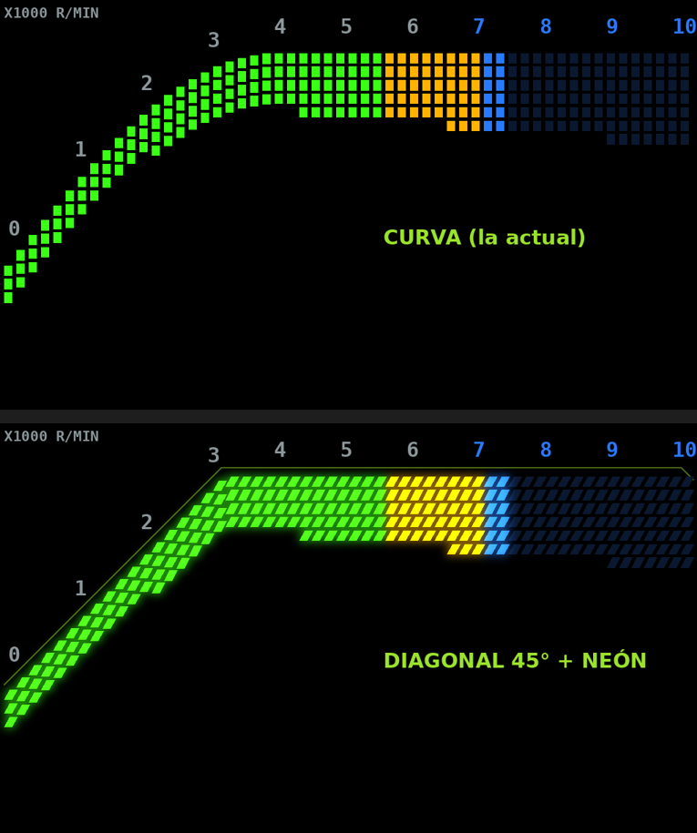
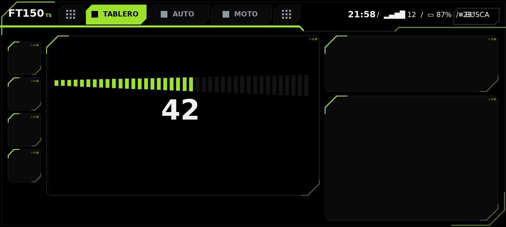

<div align="center">



<br/>

**El tablero que la FT150TS no traía de fábrica.**

Tablero digital + launcher para Android que funciona **solo con el teléfono** del manubrio
y está listo para una tarjeta **ESP32** en la moto.

[![Android][android-shield]](#empezar)
[![Kotlin][kotlin-shield]](app/src/main/java/com/xof/ft150ts)
[![Jetpack Compose][compose-shield]](app/src/main/java/com/xof/ft150ts/ui)
[![ESP32-S3][esp32-shield]](firmware/ft150ts_dashboard)
[![Versión][version-shield]](LEEME.md)

**[Qué hace](#qué-hace)** · **[Empezar](#empezar)** · **[La tarjeta ESP32](#la-tarjeta-esp32)** · **[Historial completo](LEEME.md)**

</div>

---

## Por qué

El teléfono ya iba en el manubrio de la moto. En vez de solo mirar el mapa, se vuelve el **tablero completo**:
velocidad, RPM, marcha, inclinación, mantenimiento, gasolina y navegación, con un diseño pixel y deportivo
pensado para la FT150TS. Sin cables extra: las RPM salen de la **vibración del motor** que siente el teléfono.
Cuando llegue la tarjeta ESP32, ella manda los datos que el teléfono no puede medir (voltaje, temperatura, RPM
directas) y la app se cambia sola.

## Qué hace

<div align="center">


</div>

| Capacidad | Qué te da |
| --- | --- |
| **Tablero LCD Sport** | Barra de RPM curva o diagonal a 45°, dígitos de 7 segmentos, marcha, shift light y animación de arranque (las RPM suben al tope y regresan, como al dar switch). |
| **RPM sin sensor** | La vibración del motor por FFT de 3 ejes, peine de armónicos y filtro de Kalman. Se calibra en 6 s en ralentí. |
| **Marcha** | Velocidad + RPM + la marcha anterior en un filtro de probabilidad: no marca "4ª a 17 km/h". |
| **Aguja con PID** | La aguja tiene inercia de verdad; Kp, Ki y Kd ajustables con gráfica de respuesta. |
| **Mapa** | OpenStreetMap que gira suave con la brújula, satélites y doble frecuencia L5, dónde dejé la moto, límite de velocidad, "llévame a casa". |
| **Modo moto** | El cable de la moto hace de switch: carga = tablero, sin carga = tus apps. Etiqueta NFC del soporte y **modo sueño** cuando carga sin moverse. |
| **Launcher** | Pantalla de inicio con tus apps, 4 accesos directos y tres estilos de íconos (normales, pixel, LCD). |
| **Rodadas** | Cada rodada se graba sola; mírala en el mapa pintado por velocidad y **repítela** x10/x30/x60. Aviso de descanso. |
| **Arrancones** | 0-40/60/80, 100 m y 1/8 de milla con semáforo y tiempo de reacción, y prueba de frenado 40→0 (en lugar cerrado). |
| **Lluvia en tu ruta** | Revisa el pronóstico kilómetros adelante en la dirección en que vas y te avisa antes de mojarte. |
| **Velocímetro vs GPS** | Cuánto marca de más tu velocímetro y a cuánto vas de verdad. |
| **Mantenimiento** | Odómetro del teléfono, servicios por km, bitácora de gasolina con rendimiento y **alcance**. |
| **Respaldo** | Todos tus datos en un archivo: guárdalo, compártelo o deja el automático semanal. |
| **Seguridad** | Dashcam en bucle que guarda el video si detecta un golpe, aviso de teléfono caliente, batería del cel. |
| **Clima y alertas** | Lluvia próxima, huracanes (NHC), sismos (USGS) y clima severo en el tablero. |
| **Temas** | Carbono, Vidrio, Filo, Pixel y Táctico · efecto neón · 14 colores + uno personalizado · 4 fondos. |

### La idea en una línea

> El teléfono que ya va en el manubrio se vuelve el tablero; la ESP32 le da lo que el teléfono no puede medir.

## Empezar

### 1. Compila e instala la app

Abre esta carpeta en **Android Studio**, conecta el teléfono (depuración USB) y:

```bash
./gradlew installDebug      # normal
./gradlew installRelease    # optimizada, más fluida (misma firma: no borra tus datos)
```

Requiere Android 8.0 o más nuevo. Siempre se instala **encima**: tu odómetro, marchas aprendidas y ajustes se quedan.

### 2. Calibra las RPM (una vez)

Moto en neutral, motor caliente en ralentí y el teléfono en el soporte:
**Ajustes > Sin la tarjeta > Calibrar en ralentí** (6 segundos).

### 3. Escoge tu estilo

**Ajustes > Apariencia**: tema, color de acento, neón, fondo, forma de la barra de RPM y la animación de entrada.

## La tarjeta ESP32

Firmware en [`firmware/ft150ts_dashboard`](firmware/ft150ts_dashboard), placa **ESP32-S3**, particiones *Huge APP*:

```bash
arduino-cli compile --fqbn espressif:esp32:esp32s3:PartitionScheme=huge_app firmware/ft150ts_dashboard
```

Antes de subirlo cambia la contraseña de la red WiFi de la tarjeta (`AP_PASS`) y, si quieres, la de tu casa
(`STA_SSID` / `STA_PASS`).

## Temas

<div align="center">

<br/><sub>Tema Filo: barra integrada con segmentos a 45° y todo dentro de un marco tipo visor.</sub>
</div>

## Hoja de ruta

- [x] Tablero LCD Sport y Clásico con aguja PID
- [x] RPM por vibración, marcha por velocidad + RPM
- [x] Modo moto, NFC, modo sueño
- [x] Temas Filo, Pixel y Táctico, neón y colores personalizados
- [x] Respaldo y restaurar todos tus datos en un archivo
- [x] Modo arrancones (0–60 km/h, 1/8 de milla, semáforo) y prueba de frenado
- [x] Lluvia en tu ruta
- [x] Repetición de rodadas coloreada por velocidad
- [x] Error del velocímetro contra el GPS
- [x] Logros pixel (y un secreto)
- [ ] Antirrobo (con la ESP32)
- [ ] Temperatura del motor, nivel de gasolina real y presión de llantas (con la ESP32)

## Estructura

```
app/                      App de Android (Kotlin + Jetpack Compose)
  src/main/java/com/xof/ft150ts/
    ui/                   Pantallas, temas, barra integrada, animaciones
    *.kt                  GPS, sensores, RPM, marcha, modo moto, modo sueño...
firmware/
  ft150ts_dashboard/      Firmware del ESP32-S3 (Arduino)
docs/                     Banner animado, GIFs e imágenes
LEEME.md                  Guía completa e historial de versiones
```

---

<div align="center">

Hecho por **XOF** para su Italika FT150TS.

<sub>Tipografías Chakra Petch, Russo One y Press Start 2P con licencia OFL ([LICENCIAS_FUENTES.txt](LICENCIAS_FUENTES.txt)) · Mapas © colaboradores de OpenStreetMap</sub>

</div>

[android-shield]: https://img.shields.io/badge/Android-8.0%2B-9BE22B?style=for-the-badge&logo=android&logoColor=white&labelColor=0E1113
[kotlin-shield]: https://img.shields.io/badge/Kotlin-2.1-9BE22B?style=for-the-badge&logo=kotlin&logoColor=white&labelColor=0E1113
[compose-shield]: https://img.shields.io/badge/Jetpack%20Compose-Material%203-9BE22B?style=for-the-badge&logo=jetpackcompose&logoColor=white&labelColor=0E1113
[esp32-shield]: https://img.shields.io/badge/ESP32--S3-firmware-9BE22B?style=for-the-badge&logo=espressif&logoColor=white&labelColor=0E1113
[version-shield]: https://img.shields.io/badge/versi%C3%B3n-2.9-9BE22B?style=for-the-badge&labelColor=0E1113
