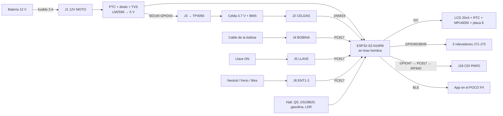

# Cómo armar y conectar la placa base FT150TS (placa B v2.3)

Guía para soldar la placa, probarla por partes y conectarla a la moto (Italika FT150TS).
- **Esquemático:** [`esquematico/ft150ts_B_esquema.pdf`](esquematico/ft150ts_B_esquema.pdf). Funciona por etiquetas: mismo nombre = mismo cable.
- **Lista de piezas:** [`LISTA_COMPRAS.md`](LISTA_COMPRAS.md).
- **Vistas de la placa:** [`fabricar/B_JLCPCB/B_top.png`](fabricar/B_JLCPCB/B_top.png) y [`B_bottom.png`](fabricar/B_JLCPCB/B_bottom.png).

## 1. Cómo funciona (resumen)

- **Alimentación:** con la moto, los 12 V pasan por el fusible reseteable (PTC), el diodo contra polaridad invertida (1N5822) y el TVS contra picos (P6KE22A). Después, el LM2596 los baja a 5 V.
- **Respaldo:** sin moto, la celda de 3.7 V alimenta al ESP32 por el 1N5819. Los relevadores solo funcionan con la moto encendida.
- **Señales de la moto:** entran por optoacopladores PC817, así que el ESP32 nunca toca directamente los 12 V ni los cientos de volts de la bobina.

## 2. Orden para soldar y probar

Suelda de lo más bajo a lo más alto y **prueba cada etapa antes de seguir**. Los puntos de prueba TP1–TP4 (12V, 5V, 3V3 y GND) sirven para medir con el multímetro.

1. **Fuente:**
   - Piezas: F1 (PTC), D1, D2, C1, C2, U2 (LM2596), L1, D7, C3, C4, D3 y J1.
   - Prueba: conecta 12 V de una fuente o una batería **sin el ESP32 puesto**. Debe marcar **TP1 ≈ 11.5 V** y **TP2 ≈ 5.0 V**. Si el LM2596 se calienta sin carga, revisa D7 y L1.
2. **Respaldo y mediciones:**
   - Piezas: J2, D4, C5, y los divisores R1–R4 con C6 y C7.
   - Carga (opcional): Q5, Q6, R5–R8 y J3.
3. **Tiras hembra del ESP32 (U1A y U1B):**
   - Antes de soldarlas, **mide tu ESP32**: las filas deben estar a **25.40 mm** (la copia ancha N16R8). El DevKitC-1 original no entra.
   - Pon el ESP32 y mide **TP3 ≈ 3.3 V**.
4. **Entradas aisladas (U11–U14 con sus resistencias y diodos):** prueba con la consola del firmware que LLAVE y NEUTRAL cambian al darles 12 V.
5. **RPM (J4, D5, R9 de 1 W, D6, C8 y U9).**
6. **Sensores y buses:** J7–J17, R20–R27 y Q7–Q8.
7. **Relevadores (U71–U73, Q71–Q73, D71–D73, LEDs y K1–K3):** usa **JQC-3FF-S-Z de 5VDC**. Prueba cada uno desde la consola.
8. **Corte de chispa, al final y solo si lo vas a usar:** U15, R28, R31, DZ1, Q9 (IRF840), D8 y J18. Lee primero `../firmware/HARDWARE-CORTE-CHISPA.md`.

**Polaridad (fíjate antes de soldar):**
- **Diodos:** la raya va hacia la **K** de la serigrafía.
- **Electrolíticos:** la pata larga va al **+**.
- **PC817:** el punto va en el pin 1, que es el pad cuadrado.
- **BC547:** el orden de patas es C-B-E.
- **LEDs:** la pata larga es el ánodo.

## 3. Conexiones a la moto (borneras)

Los colores de los cables cambian según el año de la moto. **Confirma cada cable con el multímetro** antes de conectarlo.

| Bornera | Serigrafía | Qué conectar |
|---|---|---|
| J1 | 12V MOTO: + - | + directo de la batería, con **fusible de línea de 3 A** cerca de la batería, y − a chasis. Es corriente fija: la placa se queda despierta para el anti-robo y se duerme sola |
| J5 | LLAVE GND | Cable que tiene 12 V **solo con la llave en ON** |
| J6 | ENT1 ENT2 ENT3 GND | ENT1 = cable del **foco de neutral** (en neutral se va a tierra). ENT2 y ENT3 quedan libres (freno, direccionales…). Aceptan de 3.3 a 16 V |
| J4 | BOBINA GND | Cable de disparo de la bobina (el que va del CDI a la bobina) y tierra. Ahí hay cientos de volts: aísla bien |
| J18 | CDI PARO CHASIS | Cable de paro ("kill") del CDI, el que se va a tierra al apagar con el switch del manubrio. **Solo si armaste el corte de chispa** |
| J10 | GAS GND | Cable del flotador de la gasolina |
| J7 | HALL 5V 3V3 G S | Sensor Hall de velocidad (en la rueda o en el piñón) |
| J8 | QS GND | Sensor de la palanca para el quickshifter (opcional) |
| J9 | DS18B20 5V 3V3 G D | Sensor de temperatura |
| J11 | LDR 3V3 S | Fotorresistencia, para el brillo automático |
| J12 | I2C 3V3 G SDA SCL | MPU6050, RTC o la **placa E** (expansión) |
| J13 | LCD 5V G SDA SCL | Pantalla LCD 20x4 con su módulo I2C |
| J14 | BOTONES ARR ABA OK G | 3 botones a tierra |
| J15 | SD 5V G CS MO CK MI | Módulo de tarjeta micro SD |
| J16 | GPS 5V G TX RX | Módulo GPS: su TX va a "TX", que llega al GPIO41 |
| J17 | LEDS 5V G D | Tira WS2812B (shift light) |
| J71–J73 | RELE NA COM NC | Contacto seco: **máximo ~3 A por la pista**. Para cargas mayores, activa un relevador automotriz. El relevador 1 es el del bloqueo anti-robo |
| J19 | SALIDA C E | Salida aislada de colector abierto (hasta 50 mA) |
| J2 | CELDAS 3.7V: + - | Celda(s) 18650 o LiPo **con su BMS** |
| J3 | A TP4056: + - | Entrada IN+/IN- del módulo TP4056; sus salidas B+/B- van a la celda |

## 4. Pines del ESP32 (para el firmware)

| GPIO | Función | GPIO | Función |
|---|---|---|---|
| 1 | Voltaje de la moto (100k/22k) | 17 | Hall (velocidad) |
| 2 | Gasolina | 18 | Neutral (opto: **en neutral lee HIGH**) |
| 3 | Entrada 2 | 21 | Llave ON |
| 4 | Voltaje de la celda (100k/100k) | 38 | Relevador 2 |
| 5 | LDR | 39 | Tira de LEDs |
| 6, 7, 15 | Botones | 40 | Relevador 1 (anti-robo) |
| 8, 9 | I2C SDA / SCL | 41, 42 | GPS RX / TX |
| 10–13 | Tarjeta SD | 43 | Activa la carga de la celda |
| 14 | DS18B20 | 44 | Salida aislada |
| 16 | RPM | 45 | Relevador 3 |
| 46 | Entrada 3 | 47 | Corte de chispa |
| 48 | Quickshifter (ojo: en la copia N16R8 también lleva el LED RGB de la placa) | | |

**Pendiente en el firmware v1.5:** todavía usa los pines de antes. Cuando llegue la placa hay que cambiar:
- `NEUTRAL_ACTIVO_BAJO = false`.
- `PIN_CORTE_CHISPA = 47`.
- Agregar los relevadores 2 y 3, la carga, las entradas 2 y 3 y la salida aislada.

## 5. Antes de subirla a la moto
- [ ] TP1, TP2 y TP3 con los voltajes correctos.
- [ ] Sin cortos entre 12V y GND, ni entre 5V y GND: mide resistencia con la placa sin alimentar.
- [ ] `MODO_SIMULADOR = 0` en el firmware.
- [ ] Fusible de línea de 3 A en el +12 V.
- [ ] La placa dentro de su caja (`../carcasa/caja_tablero/`), lejos del escape.
